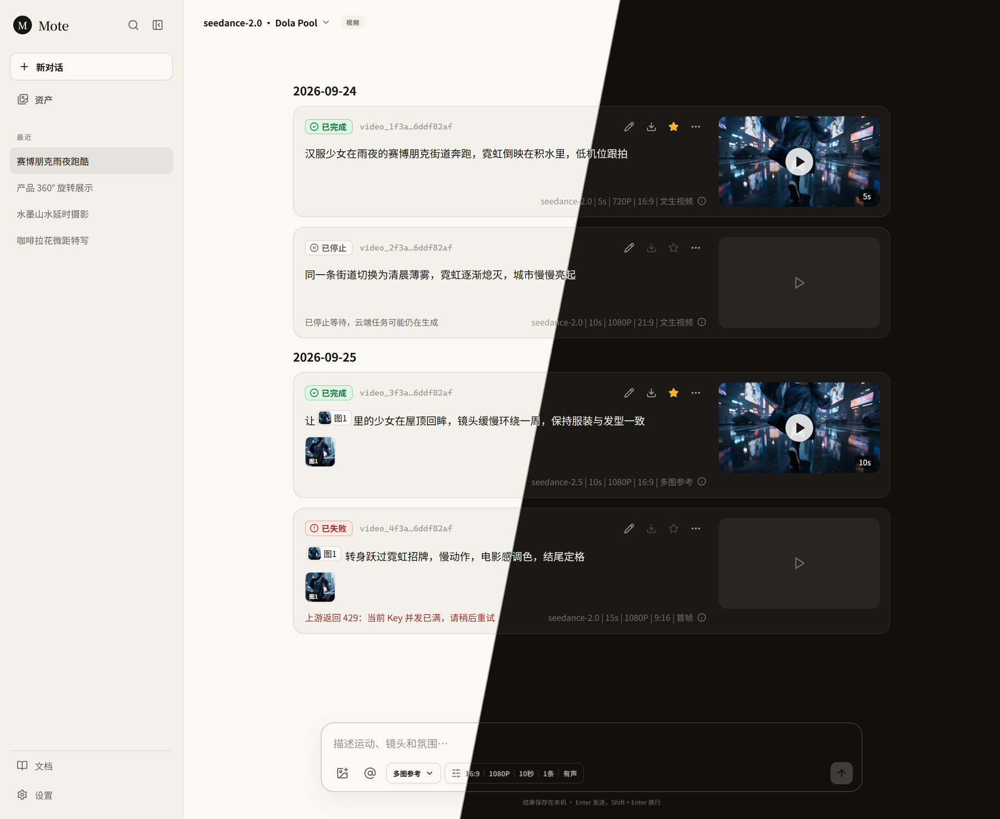
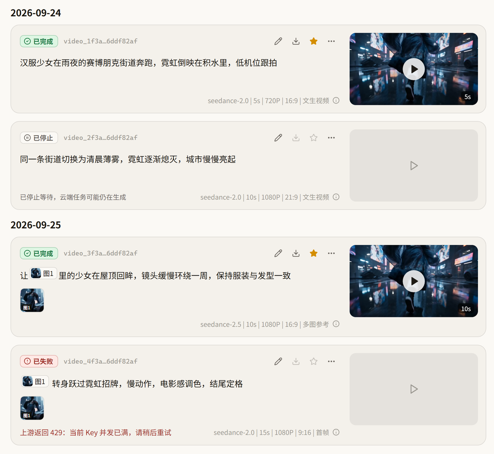
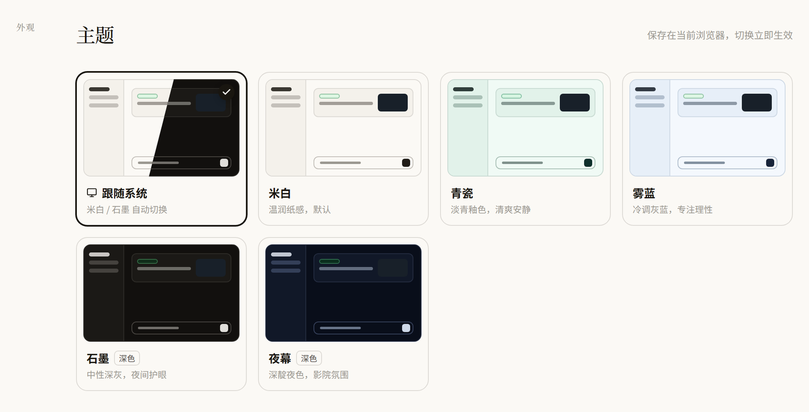

<div align="center">




### 把想法写下来，剩下的交给视频模型。

一个运行在自己电脑上的 AI 视频创作工作台。<br />
接入 Dola Pool、火山方舟等视频接口，任务、素材与成片全部留在本地。

[](https://nextjs.org/)
[](https://www.typescriptlang.org/)
[](#本地优先)
[](#开发与检查)

</div>

---

## 亮点

| 任务卡片 | @ 引用参考图 | 收藏与资产库 | 五套主题 |
| :--- | :--- | :--- | :--- |
| 每次生成是一张卡片：状态、任务 ID、参数和预览一目了然，支持重新编辑、重新生成与下载。 | 在输入框里键入 `@`，就地选择参考图，图片以缩略图卡片嵌入文字中，发送时自动编号为 `[图N]`。 | 星标收藏的视频集中出现在资产库「收藏」中，进出回收站也不丢失。 | 米白、青瓷、雾蓝、石墨、夜幕，或跟随系统自动切换深浅色。 |

## 每一次生成，都是一张任务卡片

生成结果不再是一段孤零零的视频。卡片把一次任务需要的信息收在一起：

- **状态**：已完成 / 生成中（实时计时）/ 已失败（附带上游原因）/ 已停止。
- **提示词与参考图**：`[图N]` 引用显示为带缩略图的小标签，下方列出全部参考素材。
- **参数**：模型、时长、分辨率、比例和参考模式；悬停 ⓘ 查看供应商、模型 ID 与完整任务 ID。
- **操作**：重新编辑（把提示词、参考图和参数放回输入框）、下载、收藏，以及复制提示词、复制任务 ID、重新生成、删除记录。
- **预览**：悬停静音预览，点击进入全屏播放器，支持键盘切换与下载。

<p align="center">
  
</p>

## 用 @ 把参考图写进提示词

在输入框中键入 `@`（或点击 `@` 按钮），选择框会在光标位置弹出，列出当前对话上传的图片和资产库中的图片。选中后图片以缩略图卡片嵌入文字流，右下角标出编号：

```text
让 [图1] 里的少女在屋顶回眸，镜头缓慢环绕一周
```

- 编号与发给上游的参考图顺序一致，同一张图引用两次会复用同一个编号。
- 删除上方的参考素材，引用它的卡片会一并移除，其余编号自动更新。
- 上传的素材以叠放缩略图显示，悬停展开文件名。

> 选择「首帧」模式时只会发送第一张参考图；需要多张时请切换到「多图参考」。

## 主题

设置页提供五套主题和「跟随系统」。每张主题卡片都用该主题的真实色板绘制迷你工作台，点击即时生效，偏好保存在当前浏览器，刷新不闪烁，多个标签页之间自动同步。

<p align="center">
  
</p>

## 支持的接口类型

| 接口类型 | 鉴权方式 | 对话 | 图片 | 视频 |
| :--- | :--- | :---: | :---: | :---: |
| Dola Pool 视频 | Bearer API Key | — | — | ✓ |
| 火山方舟 | Bearer API Key | ✓ | ✓ | ✓ |
| OpenAI Compatible | Bearer API Key | ✓ | 取决于上游 | 取决于上游 |
| 即梦视觉 | Volcengine AK / SK | — | ✓ | ✓ |
| 可灵 API 2.0 | Bearer API Key | — | ✓ | ✓ |

> 模型能力以上游官方文档为准。Mote 会在请求发出前拦截不支持的参考图数量、时长和生成模式，避免无效调用。目前所有接口只接受**图片**作为参考素材。

## 快速开始

### 1. 启动

```bash
git clone https://github.com/Roins-hub/openCreator.git
cd openCreator
npm install
npm run dev
```

打开 [http://localhost:3000](http://localhost:3000)。

### 2. 接入 Dola Pool

进入左下角 **设置**，添加供应商：

```text
接口类型: Dola Pool 视频
Base URL: https://dola.tangzhi.org/v1
API Key:  Dola 管理面板「API 密钥」中创建的客户 Key
```

填好 Key 后直接点击 **同步上游模型**，Mote 会调用 `/v1/models` 自动填入模型列表，无需手动填写 Model ID。保存后回到首页选择视频模型即可生成。

Dola 适配使用以下接口：

| 用途 | 接口 |
| :--- | :--- |
| 同步模型 | `GET /v1/models` |
| 创建任务 | `POST /v1/videos/generations`（参考图以 data URI 放在 `reference_images`） |
| 查询任务 | `GET /v1/videos/{id}` |

比例与分辨率会换算成 Dola 的 `size` 参数，例如 16:9 + 1080P → `1920x1080`。

<details>
<summary><strong>其他供应商的 Base URL 示例</strong></summary>

| 服务 | Base URL |
| :--- | :--- |
| 火山方舟 | `https://ark.cn-beijing.volces.com/api/v3` |
| DeepSeek | `https://api.deepseek.com` |
| 即梦视觉 | `https://visual.volcengineapi.com` |
| 可灵 API 2.0 | `https://api-singapore.klingai.com` |

保存前可以点击模型右侧的 **测试**，检查地址、凭证和模型配置。连通性测试不会发起付费生成。

</details>

### 分享给没有 Node.js 的朋友

项目可以生成内置 Node.js 的便携包，对方解压后双击 **Start Mote** 即可使用：

```bash
npm run dist:portable -- win-x64     # Windows 64 位
npm run dist:portable -- mac-arm64   # Apple Silicon Mac
npm run dist:portable -- mac-x64     # Intel Mac
```

压缩包位于 `dist/`。配置、API Key、会话和生成内容保存在解压目录下的 `data/`、`out/` 中，转发软件时不要带上自己的 `data/`。

## 本地优先

Mote 没有用户系统、远程数据库或遥测服务，所有内容保存在本机：

```text
data/
├── config.json             # 供应商、模型与密钥配置
├── favorites.json          # 收藏的资产
└── conversations/          # 会话与生成任务记录（含参数快照）

out/
├── uploads/                # 上传的参考图片
├── images/                 # 生成的图片
├── videos/                 # 生成的视频
└── .trash/                 # 资产回收站
```

- 密钥不会写入浏览器存储；设置页显示遮罩值，只有点击眼睛按钮才从本机读取。
- 主题偏好保存在浏览器 `localStorage`，不含任何敏感信息。
- `data/`、`out/`、`.env*` 已加入 `.gitignore`，不会被提交到仓库。
- 上游返回的临时媒体地址会被尽快下载到 `out/`。

## 项目结构

```text
src/
├── app/
│   ├── api/                # 配置、模型同步、会话、生成、任务、资产与收藏接口
│   ├── assets/             # 资产库页面
│   ├── docs/               # 使用文档页面
│   └── settings/           # 设置页面（主题 + 模型供应商）
├── components/
│   ├── app-shell.tsx       # 工作台主界面与 @ 引用输入框
│   ├── video-task-card.tsx # 视频任务卡片与全屏播放器
│   ├── theme-picker.tsx    # 主题选择
│   └── ...
└── lib/
    ├── providers/          # Dola、方舟、OpenAI、即梦与可灵适配器
    ├── prompt-references.ts# 输入框内容 ↔ [图N] 提示词转换
    ├── themes.ts           # 主题定义与首帧加载脚本
    ├── *-store.ts          # JSON、媒体、资产与收藏存储
    └── schemas.ts          # 配置和请求校验
```

技术栈：**Next.js 16 · React 19 · TypeScript · Zod · Vitest**。

## 开发与检查

```bash
npm test
npm run typecheck
npm run lint
npm run build
```

## 当前边界

- 单用户、本机使用，不包含登录、权限和多设备同步。
- Dola Pool、即梦视觉和可灵暂不支持远端取消任务：点击停止会结束本机等待，云端任务可能继续执行。
- 早期版本生成的记录没有保存参数快照，任务卡片上只显示模型名。
- 连通性测试不会发起付费生成，最终效果仍需要用自己的凭证实际验证。

## 致谢

本项目基于 [hughedward/openCreator](https://github.com/hughedward/openCreator)（Mote）二次开发，在其对话、图片、视频工作台的基础上增加了 Dola Pool 适配、视频任务卡片、@ 参考图引用、资产收藏和主题系统。原项目仓库未声明开源许可证，公开发布或商用前请先取得原作者授权。

---

<div align="center">

**Mote** — quiet tools for noisy ideas.

</div>
